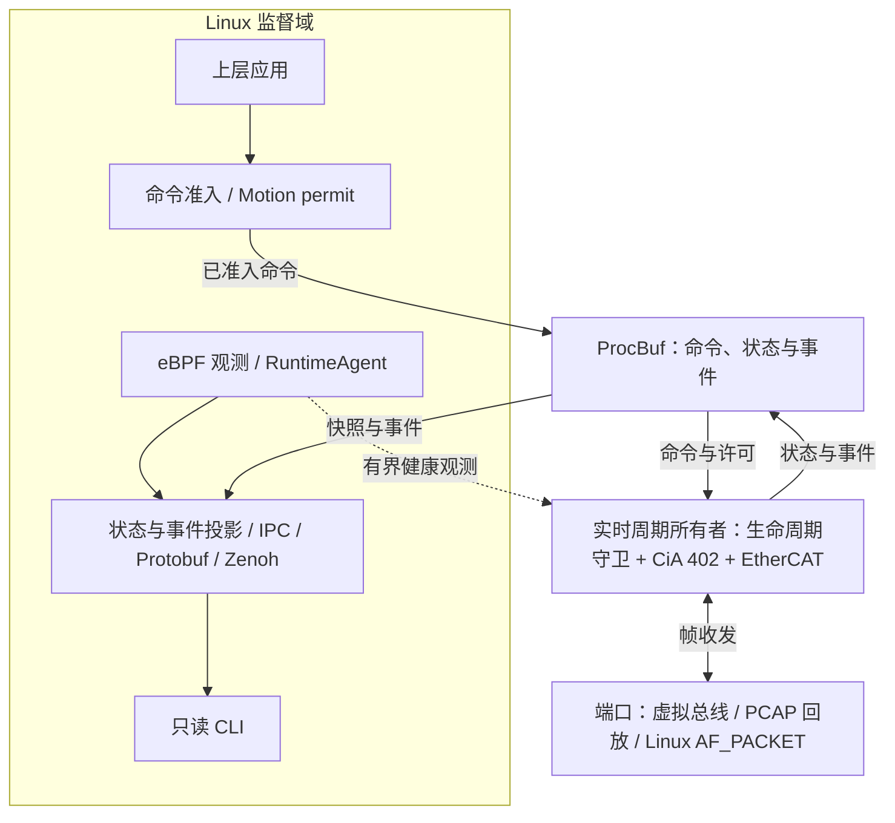

# ESOP

[](https://github.com/ra1mj/ESOP/actions/workflows/ci.yml?query=branch%3Amain)

**ESOP = EtherCAT Simple Operating System**

ESOP 是面向机器人与机器控制的 Rust 实时控制运行时。它以固定容量、激活后无堆分配的
`no_std` EtherCAT 主站为核心，将周期通信、驱动控制和生命周期防护与 Linux 监督、网络及诊断分开。

当前已完成 Linux 软件主站的 R0–R2 闭环：可通过独立虚拟从站运行扫描、配置、运动、
故障停止和显式恢复，并生成可回放的报文与运行证据。

[软件主站手册](docs/esop-linux-software-master.md) · [能力清单](capability_manifest.json) · [软件 PRD](docs/esop-software-prd.md)

## 核心能力

| 领域 | 当前软件能力 |
| --- | --- |
| EtherCAT 主站 | 在线扫描、SII、AL 状态机、SM/FMMU/PDO 配置与回读、多 Domain 调度、WKC 与完整输入提交 |
| 邮箱与 CoE | Expedited/segmented SDO、Repeat Request/ACK、Emergency、固定容量请求队列；仿真基线为八请求、每对象 1 KiB |
| 时钟与运动 | DC 发现、时钟及 SYNC 配置、周期同步；CiA 402 CSP/CSV/CST 模式与 IO |
| 生命周期 | Motion permit、命令时效、AL/DL 新鲜度检查、故障停止、维护复位和显式重新准入 |
| 仿真与回放 | 独立 `no_std` 虚拟 ESC/总线、故障注入、绑定产品与场景的 classic PCAP 捕获及精确回放 |
| 监督与诊断 | ProcBuf、Protobuf、Unix IPC、Zenoh 网关、只读 CLI，以及 Linux eBPF 运行时证据与事件归因 |

软件验证与实物资格分别记录。真实从站互操作、物理 DC 精度、目标实时性能及 MCU 板级适配
的状态见下方[当前边界](#当前边界)和能力清单。

## 快速开始

完整开发与 CI 环境以 Linux 为准，CI 使用 Ubuntu 24.04。准备 Git、Rust stable（含 Cargo）、
Python 3、C 编译器（命令名 `gcc`）和 Make。以下仿真与回放示例无需实物设备。

```bash
git clone https://github.com/ra1mj/ESOP.git
cd ESOP
cargo run -p esop-ethercat-linux-port --example r0_r2 -- --help
```

### 运行双轴加 IO

```bash
cargo run --release -p esop-ethercat-linux-port --example r0_r2 -- \
  --backend sim --scenario full --mode csp --cycles 10000 \
  --output-dir build/r0-r2/sim
```

默认场景包含两个 CiA 402 轴和一个 DI/DO 从站，虚拟周期为 1 ms。将 `--mode csp`
改为 `csv` 或 `cst` 可运行对应的冻结产品配置。

程序通过真实线上帧格式驱动虚拟 ESC，完成配置回读、SAFEOP/OP、PDO/DC、停止及新 permit
恢复。结果写入 `build/r0-r2/sim/`，包括场景结论、分配计数、运行测量、配置与拓扑、
PCAP 抓包和方向记录文件（sidecar）。

### 精确回放同一次运行

```bash
cargo run --release -p esop-ethercat-linux-port --example r0_r2 -- \
  --backend replay --scenario full --mode csp --cycles 10000 \
  --pcap build/r0-r2/sim/trace.pcap --sidecar build/r0-r2/sim/trace.json \
  --output-dir build/r0-r2/replay
```

回放核对 TX 字节与时间，并按记录时间交付 RX。输入必须是产品、场景、模式、周期数均匹配的
完整捕获；达到容量上限的抓包前缀不能用于完整回放。详细输出格式和离线报告导入见
[软件主站手册](docs/esop-linux-software-master.md#回放和证据)。

### 负载与故障场景

| 场景 | 工作负载 | 虚拟周期 |
| --- | --- | --- |
| `full` | 双轴加 IO，支持 CSP/CSV/CST | 1 ms |
| `Q1` | 32 轴、32 从站，含低速 IO | 1 ms |
| `Q2` | 16 轴、17 从站，含 IO | 500 μs |
| `Q4` | 16 轴加 IO，持续八个并发 1 KiB SDO 请求 | 1 ms |
| `Q4-baseline` | 与 Q4 相同产品和运行序列的无 SDO 负载基线 | 1 ms |

Q 场景使用冻结的 CSP 产品。故障场景包括 `command_expiry`、`dc_fault`、`wkc_fault`、
`link_fault`、`drive_fault` 和 `supervisor_restart`。使用 `make test-master-software`
可执行预设的软件场景、回放和报告检查。

## 架构与工作区

下面展示逻辑边界；应用负责驱动周期，网络、序列化和 eBPF 观测位于监督域。



实时域仍会复核 permit 与运行前提。CLI 只查询状态和诊断；恢复、复位与运动准入由各自的
类型化控制接口和产品策略负责。监督器或网络恢复不会自动恢复运动。

| 职责 | 主要模块 |
| --- | --- |
| 实时执行与设备 | [ethercat-core](crates/esop-ethercat-core)、[lifecycle-guard](crates/esop-lifecycle-guard)、[profile-cia402](crates/esop-profile-cia402)、[device](crates/esop-device) |
| 端口与模型 | [ethercat-linux-port](crates/esop-ethercat-linux-port)、[ethercat-sim](crates/esop-ethercat-sim) |
| 产品配置 | [cfggen](crates/esop-cfggen)、[product-config](crates/esop-product-config)、[产品示例](config/examples) |
| 数据与协议 | [procbuf](crates/esop-procbuf)、[ipc](crates/esop-ipc)、[proto](crates/esop-proto) |
| 网关与诊断 | [command-gateway](crates/esop-command-gateway)、[zenoh-gateway](crates/esop-zenoh-gateway)、[cli](crates/esop-cli) |
| 运行时观测 | [ebpf-agent](crates/esop-ebpf-agent)、[ebpf-runtime](crates/esop-ebpf-runtime)、[BPF 程序](bpf) |

## 测试与证据

在 Linux 上准备格式、lint 和交叉检查组件后，可运行完整开发质量门：

```bash
rustup component add rustfmt clippy
make setup-rust
make ci
```

| 命令 | 用途 |
| --- | --- |
| `make test-master-software` | 生成配置一致性、三种运动模式、Q 场景、故障、回放及报告导入 |
| `make test-master-soak` | Q4 的 360 万个 1 ms 周期，即一小时虚拟总线时间 |
| `make ci` | Workspace 检查、测试、Clippy、release 构建、`no_std`、配置与证据合同等开发质量门 |
| `make test-zenoh` | 真实 loopback router 集成；需安装手册指定版本的 `zenohd` |
| `make r2-qualification` | 校验 R2 证据的一致性，允许合法的未合格开发基线 |
| `make r2-release-gate` | 要求真实 qualified 证据；当前硬件未合格基线应拒绝发布 |

[版本化 Q4 长稳证据](qualification/software_master_soak.json)记录了 16 轴、17 从站、360 万周期、
35,520 个完成的 SDO 请求，以及激活后零分配、零释放、零重分配。运行记录保留抓包前缀损失、
关闭时八个未完成请求和全程摘要。这是一小时**虚拟总线时间**的软件证据。

GitHub Actions 另外执行 BPF 构建、Zenoh 集成和十类特权 Linux 运行时检查，并上传报告与场景证据。
特权夹具、内核条件和测量边界见 [eBPF 观测文档](docs/esop-ebpf-runtime-observability.md)；
全部 P0 软件证据映射见[软件主站验收表](docs/esop-linux-software-master.md#原始-p0-证据映射)。

## 当前边界

- Linux `raw` 示例要求实际网络匹配冻结产品配置，当前保持运动禁止状态；它是开发/HIL 入口。
- STM32/HPMicro 板级端口属于后续适配工作。
- 真实驱动与 IO 互操作、物理 DC 精度、目标 jitter/WCET、实物长稳和生产部署仍需独立验收。
- 普通生命周期防护的功能安全认证及 EtherCAT 一致性资格属于独立工作。

具体支持声明以[能力清单](capability_manifest.json)和[已知限制](qualification/KNOWN_LIMITATIONS.md)为准。

## 文档导航

| 主题 | 文档 |
| --- | --- |
| 产品与总体架构 | [软件 PRD](docs/esop-software-prd.md)、[机器人软件规划](docs/robotics-esop-software-plan.md)、[主站需求](docs/ethercat-master-requirements.md) |
| 运行与验收 | [Linux 软件主站](docs/esop-linux-software-master.md)、[性能架构](docs/esop-performance-architecture-decision.md)、[ETG/CiA 402 决策](docs/esop-etg-cia402-master-requirements.md) |
| 配置与生命周期 | [产品配置生成](docs/esop-product-configuration.md)、[运动生命周期守卫](docs/esop-motion-lifecycle-guard.md) |
| 监督接口 | [命令网关](docs/esop-command-gateway.md)、[IPC](docs/esop-ipc.md)、[Protobuf v1](docs/esop-protobuf-v1.md)、[Zenoh](docs/esop-zenoh-gateway.md) |
| 诊断与观测 | [只读诊断 CLI](docs/esop-runtime-diagnostics-cli.md)、[eBPF 观测](docs/esop-ebpf-runtime-observability.md) |

## 许可证

仓库许可文件见 [LICENSE](LICENSE)。Rust crate 的许可声明见各自的 `Cargo.toml`。
